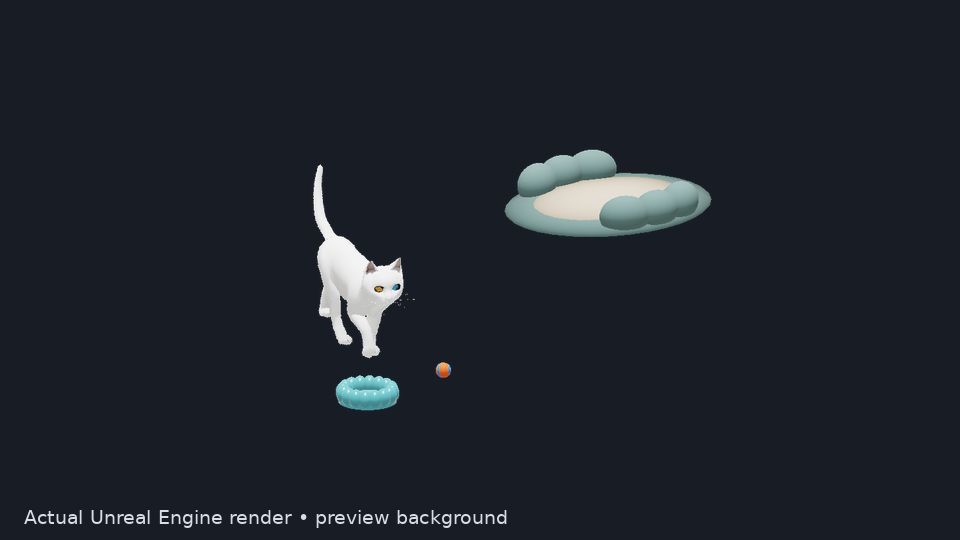
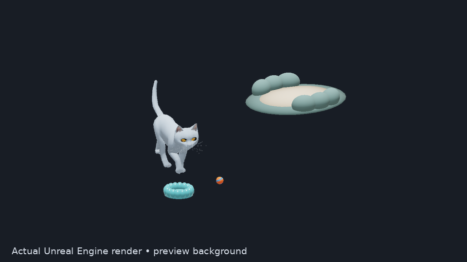
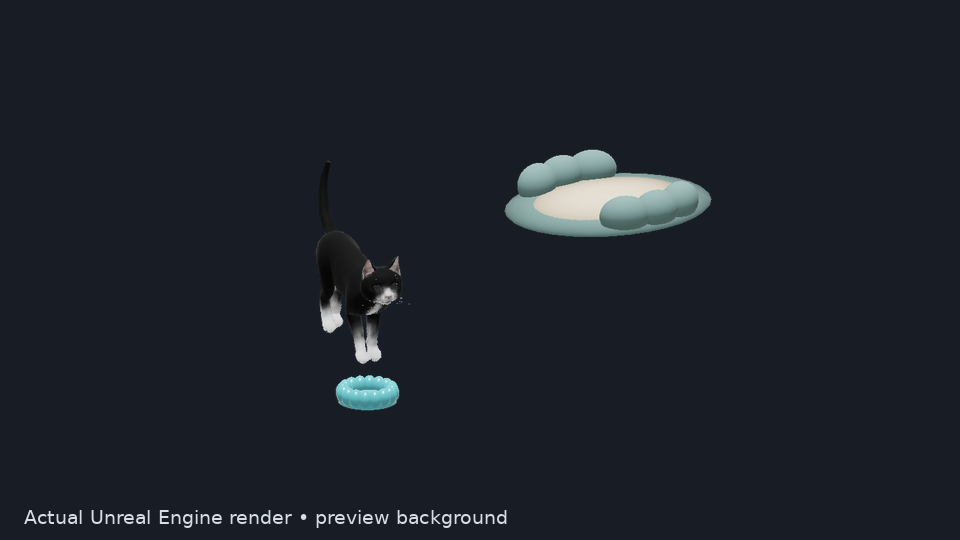

# Mırmır — a 3D desktop cat

An animated desktop companion rendered live by **Unreal Engine 5.8.4**.
Pet your cat, feed it, play with a physical toy ball and give it a bed to rest
in. Choose a Van, British Shorthair or black-and-white appearance and arrange
its furniture on your desktop.

Mırmır is an early **noncommercial prototype**. Its interface is currently
Turkish; the repository and installation guides are in English.

> **Animation reset:** the current prototype feeding and seated-rest visuals
> were rejected as unrealistic and are not release candidates. The replacement
> uses a zero-cost licensed rigged cat and Mirmir-authored behavior clips; see
> the [selection and acceptance gate](docs/research/zero-cost-cat-asset-selection-2026-10-28.md).


Actual Linux Shipping captures on an added preview background: a raised bowl,
an evaluated paw impulse and seated rest with procedural eyelids.
[Original RGBA frames and build identity](docs/media/README.md)

  

Actual Unreal game captures on an added neutral preview background.
[Watch the appearance preview](docs/media/appearance-preview.mp4) ·
[Capture details and unaltered RGBA frames](docs/media/README.md)


**[Download for Linux](https://github.com/zeynelgun-afk/Mirmir/releases)** ·
[Installation](docs/INSTALL.md) · [Current status](docs/current-status.md) ·
[Asset credits](ASSET-LICENSES.md)

## Meet your desktop cat

- Authored skeletal walk, idle and tail clips, blended with speed-dependent
  playback and procedural paw contact adjustments.
- Real meow and purr recordings, petting reactions, hunger, energy and a
  saved bond with your cat.
- A Chaos rigid-body ball with impulses requested by the cat's evaluated paw
  position and velocity, plus short, occasional interest in your cursor.
- A bed and raised feeding bowl on a stand you can move independently. Their
  positions survive restarts. Unsafe placements are rejected with an explanation.
- Swept movement and curved paths around furniture, with an open bed entrance
  and exit. Depth-tested rendering lets furniture cover the cat correctly.
- Transparent windows that avoid keyboard focus and the taskbar. Controls
  stay in the system tray beside your clock.

The appearances share one base model; they are not separate scanned breeds.
Version 0.5 uses authored sit-down, seated-idle and stand-up clips as its
rest base, with procedural eyelids, head motion, breathing and tail relaxation.
This is seated rest; there is no authored lying-down or sleep clip. Feeding
uses bounded neck/head, jaw and tongue controls at the raised bowl. Groom fur
and finished photorealism are still in progress. See the
[current status](docs/current-status.md) for the exact cooked-build evidence.

## Controls

| Action | Control |
| --- | --- |
| Pet | Click the cat, or hold the left button and stroke it |
| Feed | Click the bowl, or choose **Mama ver** in the menu |
| Rest | Click the bed, or choose **Dinlen** |
| Play | Choose **Oyna** from the cat or tray menu |
| Move the bed or bowl | Drag that item with the left button |
| Move the whole scene | Hold **Shift** and drag the cat or an item |
| Change appearance, sound or cursor interest | Right-click the cat or use the tray menu |
| Save and close | Choose **Kapat** in the tray menu |

Feeding and resting include travel to the station. If the cat is using the
bed, move it after the cat leaves. A rejected drop returns the item to its
confirmed position.

## Install

Linux x86_64 releases provide **AppImage, Flatpak, Debian, RPM, Arch and
portable archive** formats. They include the cooked game and Python/Qt shell;
running them does not require the Unreal Editor. See the
[Linux guide](docs/INSTALL-LINUX.md) for dependencies and checksum checks.

The Flatpak is distributed directly through this project's releases.
[Flathub status and permissions](docs/FLATPAK.md) are documented separately.
Windows build scripts and an Inno Setup wizard recipe are available, but a
Windows installer EXE has not been built or tested on this Linux workstation.
See the [Windows guide](docs/INSTALL-WINDOWS.md).

## Build from source

Install a licensed Unreal Engine 5.8.4 Linux build and a Vulkan graphics driver,
then run:

```bash
git clone https://github.com/zeynelgun-afk/Mirmir.git
cd Mirmir
python -m venv .venv
.venv/bin/pip install PyQt6 numpy
export PATH="$PWD/.venv/bin:$PATH"
export MIRMIR_UE_ROOT=/path/to/UnrealEngine-5.8.4
./unreal/Mirmir/scripts/build.sh -MaxParallelActions=2
./run.sh
./run.sh --stop
```

The launcher uses a cooked Shipping game when `.local/package.json` exists,
and the installed engine otherwise. `./run.sh --editor` opens the development
editor; `./run.sh --preview` opens a regular game window.

[Unreal development](unreal/Mirmir/README.md) ·
[Desktop shell and protocol](native-shell/README.md) ·
[Package recipes](packaging/README.md)

## Privacy and local data

Cat saves and furniture layout live under
`${XDG_DATA_HOME:-~/.local/share}/mirmir/unreal/`; logs live under
`${XDG_STATE_HOME:-~/.local/state}/mirmir/unreal/`. Live frames use a private
runtime directory where available. Flatpak keeps its own sandbox data.

The application does not read other apps' pixels, files or microphone input.
Cursor interest uses the current relative position locally and does not save
a pointer history. Installation does not enable autostart or change your
desktop session, display layout or window-manager settings.

## Development and verification

```bash
./scripts/check.sh
./unreal/Mirmir/scripts/test-engine.sh
./unreal/Mirmir/scripts/package-game.sh
```

Core checks use ASan/UBSan. Native-shell tests cover frame pairing, CRC,
alpha/DPI, independent placement acknowledgements, persistence and shutdown.
Actual Unreal rendering, Shipping launch, desktop window policy and package
installation are verified separately. Automated checks do not establish
photorealism or the user's acceptance of the animation.

[Current evidence and limits](docs/current-status.md) ·
[Motion research](docs/research/locomotion-2026-10-27.md) ·
[Behavior and source-rig calibration](docs/research/behavior-rig-2026-10-28.md)

## Licenses and credits

Original project code is [MIT](LICENSE); the separate PyQt shell is
[GPL-3.0-only](native-shell/LICENSE). Unreal Engine and assets have their own
terms. **The included Cat Walk model and its derivatives are CC BY-NC 4.0;
commercial use requires replacing them with a suitably licensed model.**

Cat geometry and original walk: **LostBoyz2078 / LostModels2025**, CC BY-NC 4.0.
Additional motion: **DreamNoms**, CC BY 4.0. Cat recordings: **Joseph SARDIN /
BigSoundBank**, CC0. Images and videos depict these credited assets. Source
links, changes and texture provenance are in [ASSET-LICENSES.md](ASSET-LICENSES.md).

The earlier Godot experiment in `desktop-lab/` and dated Turkish design notes
are historical archives. The current product runs on Unreal Engine.
