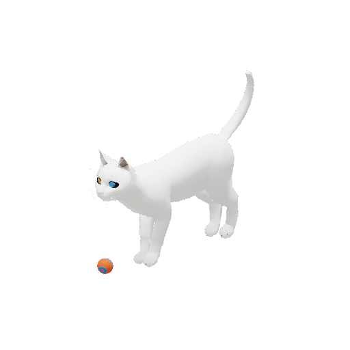
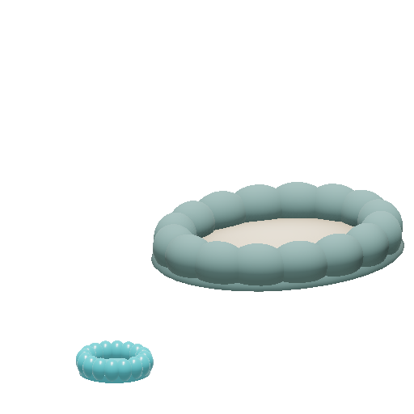
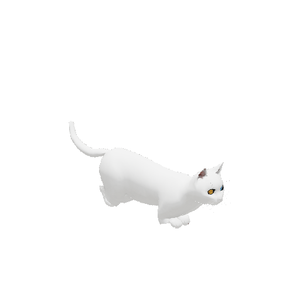

# Mırmır — a 3D desktop cat in Unreal Engine

Mırmır is an animated desktop companion rendered live by **Unreal Engine
5.8.4**. A transparent native window puts the cat on the desktop, with real
cat recordings, petting, feeding, a physical toy ball and selectable
appearances, a permanent bed and a feeding station. This is an early, noncommercial prototype; realistic turning and
contact animation are actively being improved.



The image is an unaltered game render. Cat geometry/original walk: LostBoyz2078,
CC BY-NC 4.0. Additional motion: DreamNoms, CC BY 4.0. Full sources and changes:
[asset credits](ASSET-LICENSES.md).

## Özellikler ve kullanım

- Gerçek iskeletli 3B yürüyüş, bekleme ve kuyruk hareketleri; pozlar arasında
  yumuşak geçiş, ilerleme hızına bağlı yürüyüş oynatımı.
- Van, British Shorthair ve siyah-beyaz görünüm seçimi. Bunlar aynı temel
  geometri üzerindeki profillerdir; ayrı safkan tarama modelleri değildir.
- Gerçek miyavlama/mırlama kayıtları, mama, sevme, dinlenme ve kaydedilen bağ.
- Unreal Chaos ile seken top ve kedinin topa yaklaşması.
- Sabit yatak ve mama kabı; yatağa yürüyüp çömelerek dinlenme, kaba yaklaşma
  ve yeme tepkisi. Menü eylemlerinde motorun onayladığı durum mesajı.
- Arada fareye başıyla ilgi ve kısa yaklaşma; üzerine gelince el imleci,
  severken küçük baş eğimi ve mırlama.
- Şeffaf, klavye odağı istemeyen masaüstü penceresi; sistem tepsisi menüsü.
- Hareket sırasında 30, sakin bekleyişte 8 kare/sn hedefi. Gerçek Unreal
  kareleri alpha, oturum, üretici PID ve CRC eşleşmesiyle gösterilir.

Kediyi tıklayarak veya sol tuşa basılı üzerinde gezdirerek sev. Sağ tık ya da
tepsi menüsünden mama, oyun, dinlenme, görünüm ve sesi seç.
**Shift + sürükle** başlangıç yerini taşır. Tepsiden **Kapat** uygulamayı
normal kapatır ve kaydı korur.

Yatağa tıklamak dinlenmeyi, mama kabına tıklamak beslemeyi başlatır. Mama
istendiğinde önce kaba yürür; o anki konuma göre yaklaşma birkaç saniye sürer.
“Fareye arada ilgi göster” menü seçeneği bu davranışı kapatabilir.

 

Yukarıdakiler ayrı, değiştirilmemiş Unreal RGBA kareleridir. Dinlenme pozu
prosedüreldir; kapalı göz veya sanatçının hazırladığı uyku klibi içermez.

## Kurulum ve çalıştırma

Hazır paketlerin adresi: [GitHub Releases](https://github.com/zeynelgun-afk/Mirmir/releases).
Platforma göre adımlar, bağımlılıklar ve doğrulama sınırları
[kurulum belgesinde](docs/INSTALL.md) bulunur. Hazır oyun paketinin çalışması
için Unreal Editor kurulması gerekmez. Paket dosyasının üretilmesi, her
dağıtımda kurulup çalıştırıldığı anlamına gelmez.

Kaynak koddan Linux geliştirme oturumu:

```bash
git clone https://github.com/zeynelgun-afk/Mirmir.git
cd Mirmir
python -m venv .venv
.venv/bin/pip install PyQt6 numpy
export PATH="$PWD/.venv/bin:$PATH"
export MIRMIR_UE_ROOT=/path/to/UnrealEngine-5.8.4
./unreal/Mirmir/scripts/build.sh -MaxParallelActions=2
./run.sh
./run.sh --stop
```

Yerel `.local/package.json` varsa başlatıcı Shipping paketini kullanır; yoksa
kurulu motorun oyun kipini açar. `./run.sh --editor` geliştirme editörünü,
`./run.sh --preview` normal oyun penceresini açar. Windows derleme/kurulum
sihirbazı ve Linux paket üretimi için kurulum belgesini izleyin.

## Veri ve lisans

Linux kaydı `${XDG_DATA_HOME:-~/.local/share}/mirmir/unreal/` altında,
günlükleri `${XDG_STATE_HOME:-~/.local/state}/mirmir/unreal/` altındadır.
Canlı kareler mümkünse özel `XDG_RUNTIME_DIR` tmpfs dizininde tutulur. Diğer
uygulamaların ekran görüntüsü, dosyası veya mikrofonu okunmaz. İmleç ilgisi
yalnız güncel konum farkını yerel olarak kullanır. Masaüstü oturumu ve KWin
ayarları değiştirilmez; otomatik başlangıç varsayılan değildir.

Özgün proje kodu [MIT](LICENSE), ayrı PyQt masaüstü kabuğu
[GPL-3.0-only](native-shell/LICENSE) lisanslıdır. Unreal Engine ve üçüncü taraf
varlıklar ayrı koşullara tabidir. **Dahil edilen Cat Walk modeli ve türevleri
CC BY-NC 4.0 lisanslıdır; ticari kullanım için uygun bir modelle değiştirilmeleri
gerekir.** Kod lisansı bu varlık koşulunu kaldırmaz.

## Geliştirme ve kanıtlar

```bash
./scripts/check.sh
./unreal/Mirmir/scripts/test-engine.sh
./unreal/Mirmir/scripts/package-game.sh
```

Çekirdek testleri ASan/UBSan ile çalışır; kabuk testleri kare eşleşmesi,
alpha/DPI, kayıt ve tek örnek denetimini kapsar. Unreal otomasyonu ve gerçek
Shipping çalıştırması ayrıca doğrulanır. Görsel gerçekçilik kullanıcı
gözlemiyle değerlendirilir; birim testleri bunu kanıtlamaz.

[Güncel durum](docs/current-status.md) ·
[0.4 gerçek çalışma kaydı](docs/release-0.4-verification.json) ·
[0.2 gerçek çalışma kaydı](docs/release-0.2-verification.json) ·
[hareket araştırması ve benzer GitHub projeleri](docs/research/locomotion-2026-10-27.md) ·
[Unreal geliştirme](unreal/Mirmir/README.md) ·
[yerel kabuk](native-shell/README.md)

Groom, tamamlanmış fotogerçekçilik ve kapsamlı sanatçı oturma/uyuma/temizlenme
animasyonları henüz yoktur. İlk Godot fizibilitesi `desktop-lab/` altında
arşivdir; varsayılan ürün değildir ve Unreal kanıtı sayılmaz.
