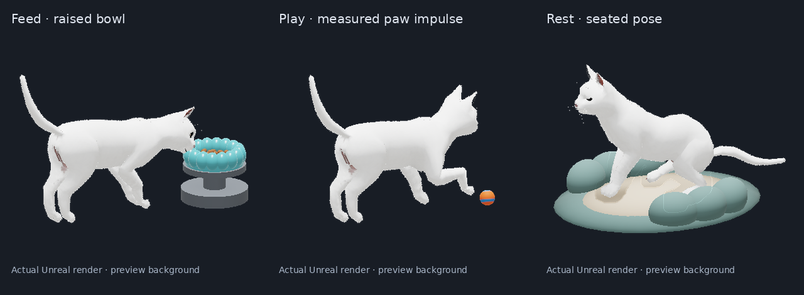

# Preview media

These images come from the application's own **Unreal Engine 5.8.4 renderer**.
They are not desktop screenshots. Actual RGBA game frames are placed on a
neutral preview background with an English caption. No other application's
pixels, pointer history, microphone or audio were captured.

## Version 0.5 Shipping behavior

The three panels show the raised feeding bowl, a measured paw impulse on the
Chaos ball and a seated doze with closed eyelids. They come from the final
Linux Shipping binary in archive `package-20261028T074553Z-1412355`, SHA256
`648617a616c3f144cc60c5a8a77a40d293f8bd55257da5a72d44b7a19a20d52a`.
Feeding and Play are selected from a full Feed → Play → Rest → Feed → Play
run. The front-profile rest panel comes from a separate stationary-rest run
of the same binary. Both processes exited normally with code 0.

All 444 archived main frames in the full run and 89 in the rest run passed
their recorded size, dimensions and CRC checks. The selected furniture PNGs
also match their captured per-item metadata and layout revisions. The panels
use one constant pixel scale, with each panel centered independently. The
CRC-matched furniture is drawn below the main image, which already contains
the renderer's depth ordering. No pose, face, texture or source PNG was edited.

Unaltered producer bytes:

- [Feeding main RGBA](raw-behavior-feed.png) and [raised bowl RGBA](raw-behavior-feed-bowl.png).
- [Play main RGBA](raw-behavior-play.png).
- [Rest main RGBA](raw-behavior-rest.png) and [bed RGBA](raw-behavior-rest-bed.png).

[behavior-provenance.json](behavior-provenance.json) records the sessions,
frame identities, original hashes, composition and per-session paw/velocity
evidence. The three stills are selected observations, not a continuous video
or proof of all layouts. Rest uses authored sit/stand clips with procedural
eyelids; it is not an authored lying/sleep clip. Near-rim lapping does not
establish tongue-to-kibble collision. The cat remains kinematic while the
ball uses rigid-body physics. Finished photorealism is not claimed.

## Earlier appearance gallery

The [Van](van.png), [British](british.png) and [tuxedo](tuxedo.png) images show
three appearance profiles on the same base mesh. They are not three separately
scanned breed models. The corresponding `raw-main-*.png` files retain the
producer's original PNG bytes, including transparency. The larger preview
images combine the CRC-matched bed, bowl and depth-composited main render.

The [appearance GIF](appearance-preview.gif) and
[appearance MP4](appearance-preview.mp4) are a silent, 24.9-second capture of
those profile changes. **The actor did not translate during that capture.**
It is an appearance gallery, not a walking demonstration or proof of final
Shipping behavior. Its capture came from a pre-release editor/game session.

[appearance-provenance.json](appearance-provenance.json) records that earlier producer
session, frame/layout identities, unchanged source hashes, display offsets,
composition and verification limits. The complete raw recording remains in
the local validation archive. `scripts/record-preview.py` records only the
explicitly supplied app frame directory and retains raw PNG/JSON separately
from the composed presentation.

Cat geometry and original walk: **Cat Walk by LostBoyz2078**, CC BY-NC 4.0.
Additional motion: **Tuxedo Cat Animated 2.0 by DreamNoms**, CC BY 4.0.
Full author/source links, modifications and generated-fur provenance are in
[ASSET-LICENSES.md](../../ASSET-LICENSES.md).
